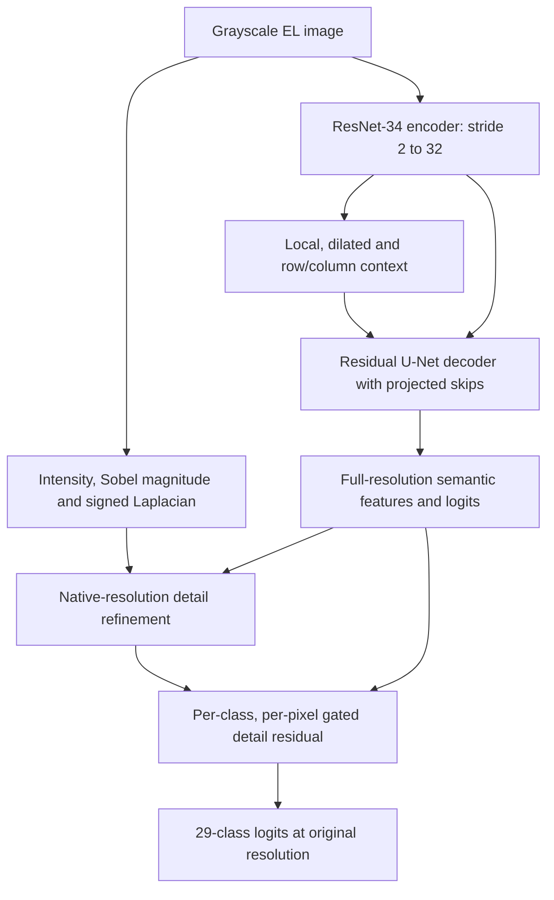

# SolarUNet v1: Experimental EL-Cell Segmentation

SolarUNet is a **candidate**, not a proven best model or a released pretrained model.
It is implemented in [solar_unet.py](solar_unet.py) and registered as `solar-unet`
with the existing training/evaluation runner. No dataset split, labels, or baseline
defaults are changed to favor it. Full GPU training and comparative evaluation remain
to be done on the server.

## Why This Design

EL segmentation has competing spatial requirements:

- Cracks and broken gridlines may be only a few pixels wide. A branch operating at
  original resolution avoids forcing all detail through a stride-32 encoder.
- Inactive regions need larger-scale context than a local edge detector provides.
- Busbars, ribbons, borders, and regular gridlines are legitimate dark structures.
  Row/column context may help distinguish them from unexpected defects.
- Dark edges are not automatically defects. The semantic decoder controls a learned
  class-specific and pixel-specific detail residual instead of thresholding an edge map.

These are testable hypotheses, not guarantees. Sobel/Laplacian features can also
amplify noise and normal cell texture. Axial context assumes approximately aligned,
rectified cells; it is not a mathematical detector of periodicity or rotation invariance.

## Architecture



The semantic encoder is timm ResNet-34, not a new implementation of a backbone.
Four decoder stages use widths 256/128/64/32, with residual refinement and GroupNorm.
Encoder BatchNorm is retained. The detail stem uses 16 channels at full resolution,
then refines its concatenation with 32 semantic channels. Context is computed at the
deepest encoder scale, keeping the axial operations inexpensive.

For the `dynamic` variant:

`logits = semantic_logits + sigmoid(class_pixel_gate) * detail_logits`

The gate shape is `[batch, 29, height, width]`, not one global scalar pair. It is
initialized near 0.12 so the untrained detail residual does not initially dominate.
The full native-29-class model has **24,450,263 parameters** in the tested environment.
Each run records its actual parameter count in `model_stats.json`.

Inputs remain grayscale float values in `[0,1]`. For pretrained runs, only the encoder
receives `(image - 0.449) / 0.226`; edge/detail features use the original intensities.
Scratch runs do not apply this encoder normalization. Mask labels are never normalized.
No weights are downloaded in scratch mode or when restoring a saved checkpoint.

## Relationship to nnU-Net and FFLUNet

nnU-Net is a general self-configuring segmentation framework, not a brain-tumor-only
model. Its experiment planning, preprocessing, training, and validation matter as much
as its network. This implementation takes the multi-resolution encoder/decoder and
optional CE+Dice training ideas, but **does not implement nnU-Net's automatic planning,
resampling, deep supervision, augmentation recipe, cross-validation, or ensembling**.
It must not be described as an equivalent or superior replacement without experiments.

The local [FFLUNet reference](../../../FFLUNet/nnunetv2/training/nnUNetTrainer/variants/fflunet/nnUNetTrainer_FFLUNet.py)
uses volumetric operators and learned static fusion weights. This model is an
independent 2D candidate, not a claimed faithful FFLUNet port. The existing CAFUNet
prototype remains a separate comparator. FFLUNet-2D and an actual nnU-Net 2D experiment
remain useful future controls.

## Controlled Variants

| `--variant` | Native-resolution detail | Axis context | Detail residual |
|---|---|---|---|
| `plain` | No | No | None |
| `detail` | Yes | No | Fixed coefficient 0.5 |
| `context` | No | Yes | None |
| `fixed` | Yes | Yes | Fixed coefficient 0.5 |
| `dynamic` | Yes | Yes | Learned class/pixel gate |

`plain` is this model's internal control, not the original U-Net architecture.
All variants keep the same encoder and semantic decoder. Disabled additions are not
allocated as unused modules. `fixed` versus `dynamic` isolates the gating addition;
`plain` versus `detail` and `context` test each architectural hypothesis separately.

## Server Commands

Transfer the updated source to the server and activate the environment first. Run
these commands from `SolarVortex/Segmentation`; see [the setup guide](../../how_to_run.md).

First validate the implementation and CUDA with one real training/validation batch:

```bash
python -m unittest evaluation.test_metrics training.test_run training.test_models -v
python -m training.run smoke --model solar-unet --variant dynamic --init scratch --loss ce-dice --batch-size 1 --device cuda
```

Start the architecture-only comparison with the same CE objective as the baselines:

```bash
python -m training.run train --model solar-unet --variant plain --init scratch --loss ce --epochs 50 --batch-size 4 --seed 42 --run-name plain-ce-seed42
python -m training.run train --model solar-unet --variant detail --init scratch --loss ce --epochs 50 --batch-size 4 --seed 42 --run-name detail-ce-seed42
python -m training.run train --model solar-unet --variant context --init scratch --loss ce --epochs 50 --batch-size 4 --seed 42 --run-name context-ce-seed42
python -m training.run train --model solar-unet --variant fixed --init scratch --loss ce --epochs 50 --batch-size 4 --seed 42 --run-name fixed-ce-seed42
python -m training.run train --model solar-unet --variant dynamic --init scratch --loss ce --epochs 50 --batch-size 4 --seed 42 --run-name dynamic-ce-seed42
```

Run sequentially. Lower the batch size if memory requires it and record the difference.
Fifty epochs is an initial budget; decide convergence and hyperparameters on validation,
not test. Keep module grouping and `--split-seed 42` fixed. Changing `--seed` changes
training randomness, not the split. Use multiple training seeds before making claims.

Separately test whether the objective helps, including a loss-matched control:

```bash
python -m training.run train --model solar-unet --variant plain --init scratch --loss ce-dice --epochs 50 --batch-size 4 --seed 42 --run-name plain-cedice-seed42
python -m training.run train --model solar-unet --variant dynamic --init scratch --loss ce-dice --epochs 50 --batch-size 4 --seed 42 --run-name dynamic-cedice-seed42
```

`--loss ce-dice` adds equal-coefficient cross-entropy and batch soft Dice loss over
GT-present foreground classes. Background is excluded only from the Dice component.
Target 255 is ignored in both components. Background-only batches have zero Dice loss;
cross-entropy still penalizes absent-class predictions. This is a documented practical
recipe, not an exact copy of nnU-Net's loss implementation. The option works for the
existing baselines too, so architecture and recipe effects can be compared separately.

Checkpoints remain selected by **validation cross-entropy**, regardless of objective.
Objective and component losses are saved separately in JSON/CSV and PNG graphs.
Batch soft Dice loss is not the dataset-level reported Dice metric.

Inspect validation predictions before freezing the experiment:

```bash
python -m training.run evaluate --run-dir results/runs/solar-unet/dynamic-ce-seed42 --eval-split val --figures 20
```

Only after choosing the protocol using validation, run held-out evaluation:

```bash
python -m training.run evaluate --run-dir results/runs/solar-unet/dynamic-ce-seed42 --eval-split test --figures 72
```

Replace the directory to evaluate each frozen run. Resume and artifact backup work
exactly as documented for the baselines. Old runs remain untouched.

## Evidence Required Before Calling It Better

Compare EL-29 per-class IoU/Dice, derived EL-10 metrics, and defect-only metrics using
the same support/undefined-class policy. Examine crack/gridline errors separately from
large inactive regions and normal busbar false positives. Report parameter count,
server latency and memory alongside quality; CPU smoke timing is not a GPU benchmark.

Use the same split, training budget, initialization regime, and seeds for comparisons.
Also compare against U-Net++/DeepLabV3+/SegFormer, CAFUNet, and the internal `plain`
control. Pretrained ResNet and ADE20K-finetuned SegFormer have different supervision
histories and must not be presented as identical-pretraining controls.

The grouped seed-42 test set has no corrosion pixels; training has no `belt_mark`.
This architecture cannot fix absent labels, establish corrosion recall on that test set,
or show generalization to a new production line without an external evaluation.
Module-grouped cross-validation, module-level uncertainty estimates, real nnU-Net 2D
controls, and more representative defect data are next steps for a defensible
solar-specific framework. No claim of publication novelty has been established.